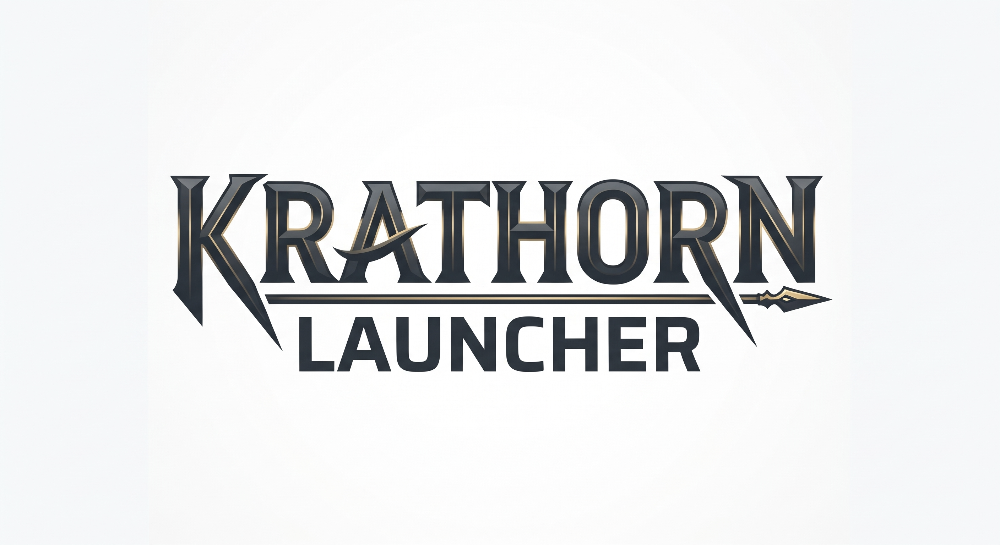
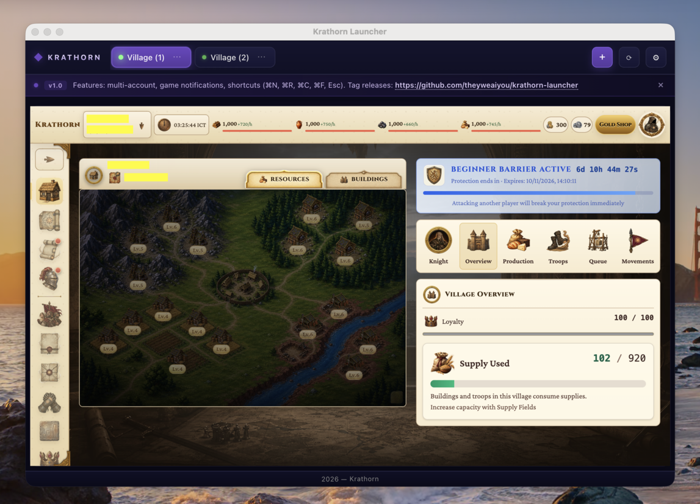
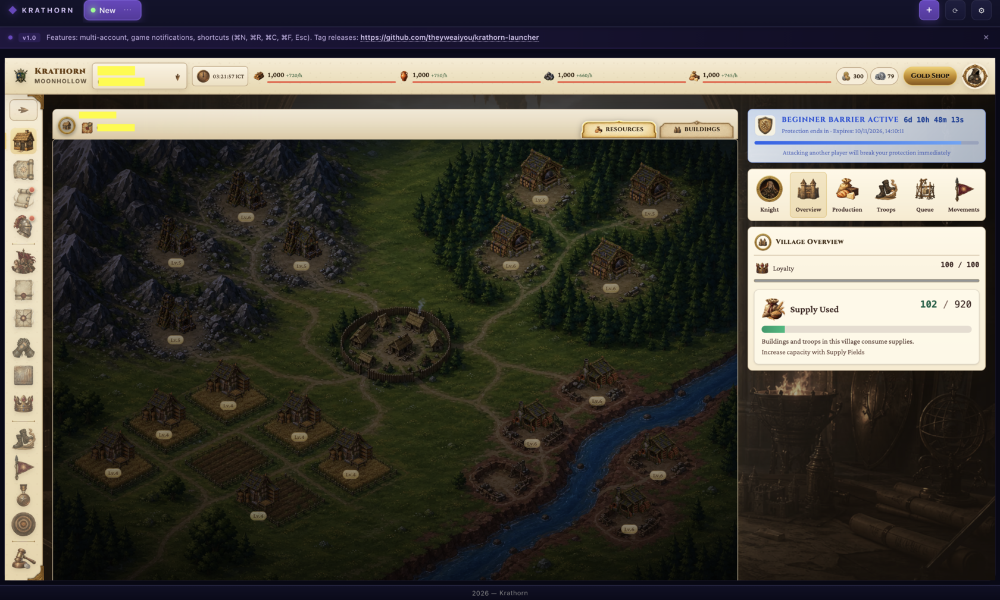
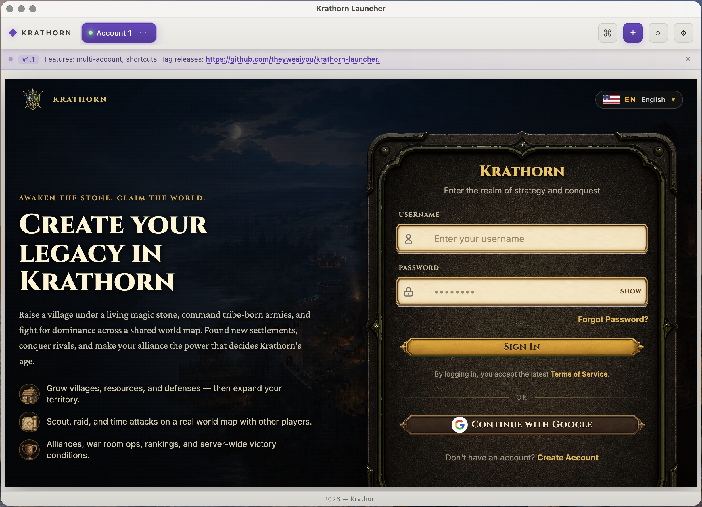

<div align="center">

# Krathorn Launcher

**A native macOS desktop launcher for [Krathorn](https://krathorn.com) — multi-account and isolated sessions.**

<br/>

[![Version][badge-version]][link-releases]
[![Platform][badge-platform]][link-releases]
[![Electron][badge-electron]][link-electron]
[![License][badge-license]][link-license]
[![PRs Welcome][badge-prs]][link-contributing]

<br/>



</div>

---

## Table of Contents

- [Why Krathorn Launcher?](#why-krathorn-launcher)
- [Features](#features)
- [Screenshots](#screenshots)
- [Requirements](#requirements)
- [Install](#install)
- [FAQ](#faq)
- [Contributing](#contributing)
- [Acknowledgments](#acknowledgments)
- [License](#license)

---

## Why Krathorn Launcher?

Krathorn is a browser game. Like most browser games, running multiple accounts in one browser means:

- **Shared cookies** — logging into account B silently logs you out of account A.
- **Shared cache / `localStorage`** — every account sees the same UI state.
- **Silent notifications** — `window.Notification` from a tab you're not looking at gets dropped.
- **Tab sprawl** — six tabs, all titled "Krathorn", and no way to tell which one has an unread message.

Krathorn Launcher fixes all of that:

| Problem | Krathorn Launcher |
|---|---|
| ☒ Shared cookies across accounts | ☑ One isolated Chromium partition per account |
| ☒ Silent / ignored game notifications | ☑ Real macOS Notification Center alerts |
| ☒ Manual reload per tab | ☑ `⌘R` reloads only the active account |
| ☒ "Which tab is which?" | ☑ Named, reorderable account chips |
| ☒ Logging out to switch accounts | ☑ One click — sessions stay warm |

---

## Features

### Multi-account

- Run **any number** of Krathorn accounts side-by-side.
- Each account gets its **own Electron session partition** (`persist:krathorn-<id>`), so cookies, cache, `localStorage`, IndexedDB, and service workers **never mix**.
- **Reorder** accounts by dragging chips in the toolbar.
- **Rename**, **reset** (logout), or **delete** any account from its `⋯` menu.
- Deleting an account also wipes its partition — no orphaned session data.

### Native notifications

- The game's `window.Notification(...)` calls are forwarded through a secure `contextBridge` to the main process.
- Alerts are re-emitted as real **macOS Notification Center** notifications, with the source account name in the title.
- **Clicking** a notification focuses the launcher and switches to the originating account.
- Notifications for the currently-active account are **suppressed** (they're already visible).

### Keyboard-first

| Shortcut | Action |
|---|---|
| `⌘N` | Add account |
| `⌘R` | Reload active account |
| `⌘C` | Close window |
| `⌘F` | Toggle fullscreen |
| `Esc` | Exit fullscreen |
| `⌘← / →` | Account switching |
| `⌘C / V` | Copy / paste selected area |

### Two themes

- **Midnight** (default) — deep purple-navy on near-black.
- **Light** — soft off-white with the same accent.
- Theme is persisted in `settings.json` and applied instantly, no restart.

### Private by design

- **No telemetry, no analytics, no network calls** beyond the game itself.
- **No bundled trackers.** The app is ~150 MB of Electron plus your accounts file.
- Everything is stored locally under `~/Library/Application Support/Krathorn Launcher/`.
- App runs under Electron's sandbox with `contextIsolation: true` and `nodeIntegration: false` throughout.

---

## Screenshots

<table>
  <tr>
    <td align="center">
      <br/>
      <sub><b>Launcher window</b></sub>
    </td>
    <td align="center">
      <br/>
      <sub><b>Midnight</b></sub>
    </td>
    <td align="center">
      <br/>
      <sub><b>Light</b></sub>
    </td>
  </tr>
</table>

---

## Requirements

| | Minimum | Recommended |
|---|---|---|
| **OS** | macOS 11 (Big Sur) | macOS 13+ |
| **Architecture** | Intel x64 *or* Apple Silicon arm64 | Apple Silicon |
| **Node.js** *(source builds)* | ≥ 18 | ≥ 20 LTS |
| **npm** *(source builds)* | ≥ 9 | ≥ 10 |
| **Disk** | ~250 MB (app + partition data) | — |

> **Windows and Linux are not currently supported.** `main.js` uses macOS-specific paths (`~/Library/Application Support/...`) and `build.sh` targets `/Applications`. See [FAQ](#faq).

---

## Install

### Option A — Test-build

1. Download the latest `.zip` from the **[Releases page][link-releases]**.
2. Open the folder through terminal **righ-click → New Terminal in Folder**.
3. Install npm dependencies on selected terminal.

   **Run**:

   ```bash
   npm install        # one time
      
   # and:
   
   npm start    # test-build
   ```
> **Test-build:** `npm start` to launch straight from source — no packaging, no code signing.

4. To close, just force close (terminate) the app.

### Option B — Build from source

1. Open terminal.

   **Run**:

  ```bash
  git clone https://github.com/theyweaiyou/krathorn-launcher.git
  cd /Users/YOUR_USERNAME/krathorn-launcher
  ls main.js package.json build.sh
  chmod +x build.sh && ./build.sh
  ```

2. If you don't know where the location, run this on the terminal `find "$HOME" -maxdepth 6 -type d -name 'krathorn-launcher' -print 2>/dev/null`.
3. Copy-paste it to the command before.

  ```bash
  build.sh will:

  1. Install npm dependencies.
  2. Detect your architecture (`arm64` or `x86_64`).
  3. Build the appropriate `.app` bundle into `dist/`.
  4. Clear the macOS quarantine flag.
  5. Quit any running instance.
  6. Remove any part from older version (if there is available).
  7. Copy the resulting bundle into `/Applications`.
  ```
  
After it finishes, launch **Krathorn Launcher** from Launchpad or Spotlight.

   > *"Krathorn Launcher cannot be opened because the developer cannot be verified."*

   **To bypass (once)**, run:

   ```bash
   xattr -cr "/Applications/Krathorn Launcher.app"
   ```

   Then **right-click → Open** in Finder, or go to **System Settings → Privacy & Security → Open Anyway**.

---

## FAQ

<details>
<summary><b>Is this affiliated with Krathorn?</b></summary>

No. This is an independent, community-built wrapper around the Krathorn web client. It doesn't modify the game, doesn't inject anything that grants an advantage, and is provided as-is under MIT. If Krathorn's team asks it to be taken down, it will be.

</details>

<details>
<summary><b>Will I get banned for using this?</b></summary>

We hope not — but we can't guarantee it. This launcher doesn't modify network traffic, spoof the user agent (beyond a standard Chrome UA), or inject anything into the game's logic. It's structurally equivalent to keeping several browser profiles open.

**However:** multi-accounting itself may violate Krathorn's Terms of Service. Use at your own risk.

</details>

<details>
<summary><b>Does it work on Windows / Linux?</b></summary>

Not currently. `main.js` hard-codes macOS storage paths and `build.sh` targets `/Applications`. A cross-platform port would need a storage-path abstraction (Electron's `app.getPath('userData')` already handles this — the macOS-specific bits are the *installer* and *build script*). PRs welcome.

</details>

<details>
<summary><b>Why does the app take ~3 seconds to open?</b></summary>

Electron cold-start plus Chromium initialisation. The splash screen covers this. Subsequent launches are faster once the OS caches the app.

</details>

<details>
<summary><b>Can I run more than one window?</b></summary>

Only one window per launcher instance. Multiple accounts live as chips inside the single window. This is a deliberate design choice — a single window with tab-like chips is faster to switch than juggling windows.

</details>

---

## Contributing

Pull requests are very welcome! For non-trivial changes, **please open an issue first** to discuss what you'd like to change — it avoids duplicated effort.

```bash
# 1. Fork the repo on GitHub, then:
git clone https://github.com/theyweaiyou/krathorn-launcher.git
cd krathorn-launcher

# 2. Branch from main
git checkout -b feat/my-new-thing

# 3. Hack, then sanity-check both paths:
npm start                    # dev loop
./build.sh                   # packaged smoke-test

# 4. Commit conventionally
git commit -m "feat: add X"
git push origin feat/my-new-thing

# 5. Open a PR
```

**Commit conventions** (loosely [Conventional Commits](https://www.conventionalcommits.org)):

| Prefix | Use for |
|---|---|
| `feat:` | New user-visible feature |
| `fix:` | Bug fix |
| `perf:` | Performance improvement |
| `refactor:` | Internal change, no user-visible effect |
| `docs:` | README, comments, screenshots |
| `chore:` | Build scripts, deps, config |

**Style notes**

- Renderer files are plain vanilla JS.
- Main process: keep IPC handlers narrow (`ipcMain.handle`), return `{ ok: boolean }` objects.
- No new runtime dependencies unless strictly necessary — the whole point is a thin shell.

---

## Acknowledgments

- **[Electron](https://www.electronjs.org)** — the app shell.
- **[electron-packager](https://github.com/electron/electron-packager)** — zero-config macOS bundling.
- **[Krathorn](https://krathorn.com)** — the game this launcher wraps.
- Everyone who's reported a bug, sent a PR, or just tried it out.

---

## License

[MIT](LICENSE) © 2026 Krathorn

---

<div align="center">

**[back to top](#krathorn-launcher)**

<sub>Made with love for the Krathorn community. Not affiliated with Krathorn or its developers.</sub>

</div>

<!-- ============================================================
     Reference-style links — keep all URL edits here
     ============================================================ -->
[link-releases]:     https://github.com/theyweaiyou/krathorn-launcher/releases
[link-license]:      https://github.com/theyweaiyou/krathorn-launcher/blob/main/LICENSE
[link-contributing]: https://github.com/theyweaiyou/krathorn-launcher/blob/main/CONTRIBUTING.md
[link-electron]:     https://www.electronjs.org

[badge-platform]: https://img.shields.io/badge/platform-macOS%2011%2B-black?logo=apple&logoColor=white
[badge-electron]: https://img.shields.io/badge/electron-30-47848F?logo=electron&logoColor=white
[badge-license]:  https://img.shields.io/badge/license-MIT-green
[badge-prs]:      https://img.shields.io/badge/PRs-welcome-brightgreen
[badge-version]:  https://img.shields.io/badge/version-1.1-blue
